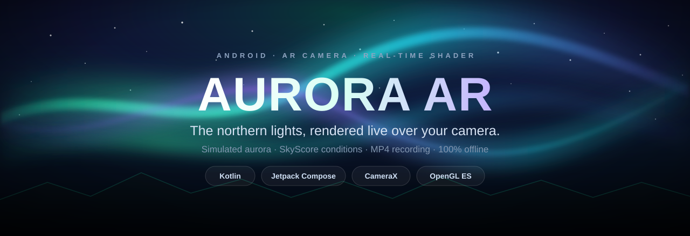
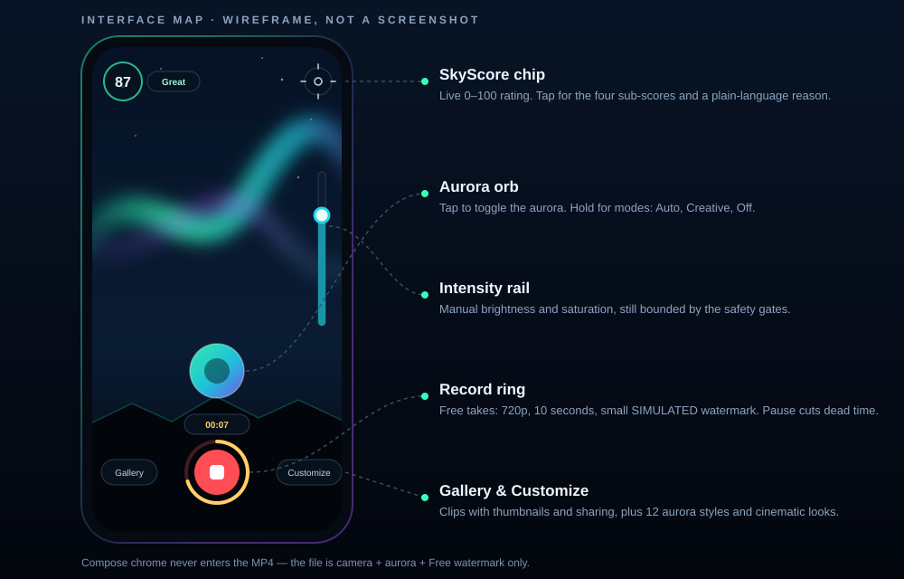
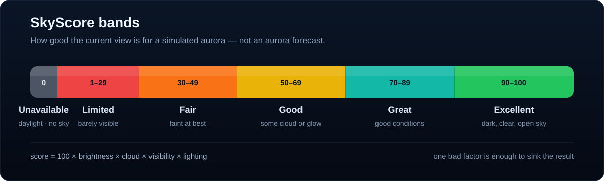
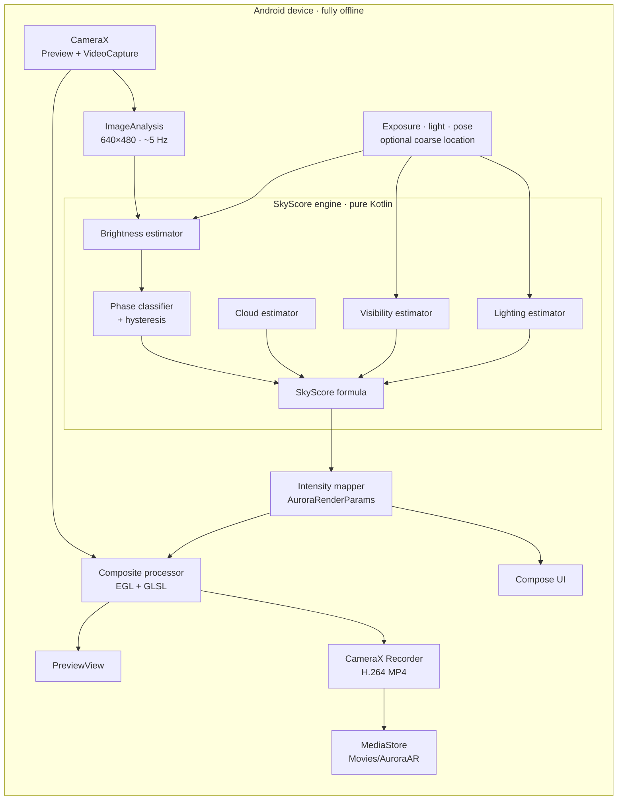
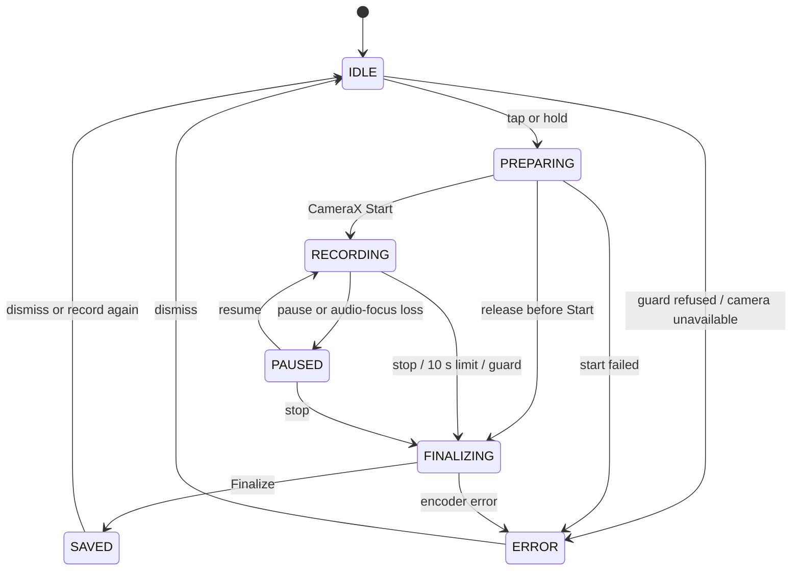

<p align="center">
  
</p>

<h1 align="center">Aurora AR</h1>

<p align="center">
  <strong>An Android AR camera that scores the sky, paints the aurora, and records the result.</strong><br>
  Real-time aurora borealis rendering, a conditions-aware SkyScore, and MP4 capture — all on-device, with no internet permission.
</p>

<p align="center">
  <a href="https://github.com/DhruvProgrammer/artifical-aurora-VR/actions/workflows/android.yml"></a>
  
  
  
  
  
  
  
</p>

<p align="center">
  <a href="#features">Features</a> ·
  <a href="#skyscore">SkyScore</a> ·
  <a href="#architecture">Architecture</a> ·
  <a href="#build-and-run">Build &amp; run</a> ·
  <a href="#documentation">Docs</a>
</p>

---

**Aurora AR** is a native Android augmented-reality camera app that paints a simulated **aurora borealis** over the live camera feed in real time. It reads the sky — brightness, clouds, stars, phone tilt and light pollution — to decide how strong the **northern lights** should look, then records the composite to MP4. The scoring engine is pure Kotlin; the compositor is a single-pass GLSL shader inside CameraX.

It is built for aurora photography experiments, night-sky and astrophotography demos, and anyone who wants a readable example of CameraX + OpenGL ES compositing on Android.

> [!IMPORTANT]
> The aurora is **simulated**. The app does not know whether a real aurora is happening, and it never fetches space weather — it has no `INTERNET` permission at all. SkyScore rates how good the current view is for showing the effect, not whether aurora will appear tonight.

---

## Features

| | Feature | What it does |
|---|---|---|
| 🌌 | **Live AR aurora** | Green, teal, violet and pink curtains drift over the camera preview at full frame rate. Twelve data-driven styles, five free. |
| 📊 | **SkyScore** | A 0–100 rating from brightness, cloud cover, visible sky and light pollution. Tap the chip for the four sub-scores and a plain-language reason. |
| 🎛️ | **Auto / Creative / Off** | Auto follows the score and switches off in daylight. Creative keeps the effect on with a dusk grade and a *simulated* badge. Off is camera-only. |
| 🎬 | **Recording** | Records exactly what you see — camera plus aurora, no app UI. Pause/resume cuts dead time from the file. Free: 720p, 10 s, watermark. Premium: 1080p, unlimited, clean. |
| 📸 | **Photos** | One tap saves the composited frame to `Pictures/AuroraAR`. No visible watermark on either plan; the simulated-origin disclosure is written as metadata. |
| 🖼️ | **Gallery & sharing** | In-app gallery with thumbnails, playback, system share, quick-share targets and delete confirmation. |
| 🔒 | **Offline by construction** | No `INTERNET`, no analytics, no ads, no upload path. Backup and device-transfer extraction are disabled. |
| 🎨 | **Premium controls** | Layer count, coverage, wave amplitude, ray sharpness, burst, direction, cinematic grades and grain — all real shader uniforms, not recolours. |

> [!NOTE]
> Premium is a local entitlement in this build. Billing is not wired, so release builds are always Free; debug builds expose a switch so both policies can be tried.

## See it

<p align="center">
  
</p>

<p align="center">
  <sub><strong>Interface map — a wireframe, not a device screenshot.</strong> Real screenshots and a sample clip will replace this after the physical-device test matrix passes.</sub>
</p>

The app has one camera screen. The aurora orb toggles the effect (hold it for Auto / Creative / Off), the ring records, the rail controls intensity, and the score chip explains the current sky. Compose chrome never enters the recorded file.

## SkyScore

<p align="center">
  
</p>

SkyScore answers one question: **how good is this view right now for drawing a believable simulated aurora?** It fuses four signals, each derived from camera features, exposure metadata or phase probabilities:

| Signal | Source | Why it matters |
|---|---|---|
| **Brightness** | Photometric estimate from shutter, ISO, f-number and sky luminance; appearance fallback when metadata is missing | Daylight drowns an aurora |
| **Cloud** | Star count at night; greyness, texture and desaturation by day; confidence-shrunk toward a neutral prior | Clouds hide the sky |
| **Visibility** | Sky-mask fraction × tilt gate | A wall, tree or the ground is not sky |
| **Lighting** | Glow, bright blobs, foreground and ambient lux, median-filtered | City light washes the effect out |

The product is intentional — one bad factor sinks the result:

```text
score = round(100 × brightness × cloud × visibility × lighting)
```

The score climbs slowly (`τ = 2.5 s`) so a passing cloud does not make the aurora pulse, and falls fast (`τ = 0.8 s`) so daylight or a covered lens is reflected immediately. A closed gate reports **0** and disables auto rendering, but still shows the sub-scores so the panel can explain what is wrong.

> [!NOTE]
> **SkyScore is not a forecast.** A score of 95 means “this sky would look great with the effect”, not “go outside, aurora is coming”. The thresholds are sensible starting values, not values fitted on thousands of real phones — a built-in calibration recorder exists so they can be fixed with real data later.

## Architecture



The scoring engine has no Android imports, so the whole path is testable on the JVM. `CompositeProcessor` is a CameraX `SurfaceProcessor` with one EGL context: it draws the camera’s external OES texture, then the aurora shader, then the Free watermark. One composited output feeds both the preview and the encoder, which is why the file matches the viewfinder.

### Recording state machine



Every mutator runs on the main thread. Start checks refuse below **100 MB** free, below **5%** battery while unplugged, or thermal `CRITICAL`; they warn below **500 MB**, **15%**, or `MODERATE`. Audio-focus loss pauses the take instead of recording over a call. Free’s 10-second limit is enforced against recorded time, not wall time.

## Build and run

**Requirements:** JDK 21, Android SDK platform 35 + build-tools 35.0.0, and an Android 8.0 (API 26) or newer device for the full experience. The toolchain is self-contained under `.toolchain/` and gitignored.

```powershell
# Windows PowerShell
$env:GRADLE_USER_HOME = "$PWD\.toolchain\gradle-home"
$env:ANDROID_HOME     = "$PWD\.toolchain\android-sdk"
.\gradlew.bat testDebugUnitTest assembleDebug
```

```bash
# macOS / Linux
export GRADLE_USER_HOME="$PWD/.toolchain/gradle-home"
export ANDROID_HOME="$PWD/.toolchain/android-sdk"
./gradlew testDebugUnitTest assembleDebug
```

Install the debug build:

```bash
adb install -r app/build/outputs/apk/debug/app-debug.apk
```

The APK lands at `app/build/outputs/apk/debug/app-debug.apk`. Every push to `main` also builds it in GitHub Actions and uploads the `aurora-ar-debug-apk` artifact. The debug package is `com.auroraar.debug`, so it can sit next to a release install. There is no Play Store release yet.

## Tech stack

| Layer | Choice |
|---|---|
| Language | Kotlin 2.0.21, coroutines + `StateFlow` |
| UI | Jetpack Compose (BOM 2024.10.01), Material 3 |
| Camera | CameraX 1.4.1 — `Preview`, `VideoCapture`, `ImageAnalysis` |
| Graphics | OpenGL ES 2.0 via EGL14, CameraX `SurfaceProcessor`, GLSL |
| Encoding | CameraX `Recorder` → H.264 MP4, MediaStore output |
| Storage | `MediaStore` on API 29+; app-specific folder + `MediaScanner` on 26–28 |
| Build | Gradle 8.9, AGP 8.7.3, JDK 21, `minSdk 26`, `targetSdk 35` |
| Tests | JUnit 4 — 164 tests across 24 classes |
| CI | GitHub Actions — unit tests + debug APK artifact |

## Project structure

```text
app/src/main/java/com/auroraar/
├── skyscore/       engine, models, policies, estimators, features (pure Kotlin)
├── camera/         CameraX session, feature extraction, exposure/lux/pose/location readers
├── capture/        recording policy/guards, CameraX effect + GL compositor, controller, watermark
│   └── gl/         EGL wrapper, camera/aurora shaders, watermark texture
├── calibration/    JSON sample recorder
├── data/           settings persistence
└── ui/             Compose screens, sheets, theme, labels
    └── components/ chrome, score ring, settings, recording controls
```

78 Kotlin files, roughly 11,700 lines. The app is intentionally small enough to read end to end.

## Testing and verification

| Check | Result |
|---|---|
| Unit tests | **164 tests / 24 classes, 0 failures** |
| Lint | **0 errors**, 10 warnings (nine dependency-update notes, one obsolete mipmap folder) |
| Debug APK | **12.2 MB**, version `0.1.3` (versionCode 4) |
| CI | `testDebugUnitTest` + `assembleDebug` on every push and PR |
| Physical device | **Partial** — Samsung Galaxy S10 (`SM-G973N`), Android 12: preview, Free 720p capture, photo, watermark, aurora, permission gate, settings and preview dialog exercised |

The test suite covers the SkyScore table and monotonicity, gate precedence, phase fusion and hysteresis, message policy, sky-mask colour plausibility, solar position, adversarial inputs (NaN/plateau stars, non-finite sliders, limited-range YUV), recording policy, safety guards, hold-to-stop, the premium catalogue, feature gating, orphan cleanup and encoder capability probing.

### First hardware run

On 13 November 2026 the debug build ran on a Galaxy S10 (`SM-G973N`, Android 12). A Free 10-second take saved a **720×1280, 10.13 s, 14.8 MB** H.264 clip to `Movies/AuroraAR`; decoded frames show the simulated aurora and the horizontal Free watermark in the bottom-right. The covered-lens gate, live SkyScore, mode menu, Customize sheet, encoder probe and saved-clip preview were also exercised. This was a pipeline check, not a beauty shot: the camera faced a wall and streetlight, so SkyScore read 3/100 and the capture used Creative mode. [A decoded frame is in the test log](docs/RECORDING_TESTS.md#4-first-hardware-frame).

> [!WARNING]
> The core capture path has now run on hardware, but the 27-case matrix is not finished. Still unverified: audio, pause/resume, share/delete, gallery playback, hold-to-record, camera flip, background/foreground during finalisation, mic denial, A/V drift, FPS, thermals and the low-battery stop. The first capture also showed the watermark's right edge clipping slightly, so its layout still needs a device pass. See [docs/PERFORMANCE.md](docs/PERFORMANCE.md) and [docs/RECORDING_TESTS.md](docs/RECORDING_TESTS.md).

## Privacy

- **No `INTERNET` permission.** The app physically cannot upload anything.
- No analytics, no ads, no telemetry, no third-party SDKs that phone home.
- `CAMERA` is required. `RECORD_AUDIO` is optional and requested only when a recording starts with sound. `ACCESS_COARSE_LOCATION` is optional and only refines the offline sun position.
- Videos go to `Movies/AuroraAR`; photos to `Pictures/AuroraAR`. Calibration recordings stay in app storage until you press Share.
- Sharing uses Android’s system chooser. The app never sends a file anywhere by itself.
- Android backup and device-transfer extraction are disabled.

## Limitations

- **The aurora is not real and not forecast.** It is a stylised procedural effect.
- **Screen-space, not world-locked.** The aurora is not occluded by foreground objects, and there is no depth or semantic segmentation.
- **Thresholds are untuned.** The calibration recorder exists, but no labelled field dataset ships with the repo.
- **CameraX owns encoding.** Bitrate and frame rate are defaults; 4K, HEVC, 60 fps and custom bitrates are not exposed.
- **Free's 10-second limit can overshoot** by the encoder's stop latency; the first hardware take saved a 10.13 s file.
- **Billing is not wired.** Release builds are always Free; debug builds expose a local Premium switch.
- **Mic revocation mid-take is not handled.** Audio focus loss pauses the take; a revoked microphone may end the audio track early.
- **No crash-resilient fragmented MP4** and no automatic file split.

## Roadmap

- [ ] Run the 27-case physical-device test matrix and publish real screenshots + a sample clip
- [ ] Measure FPS, A/V drift, duration accuracy, thermals and battery on reference hardware
- [ ] World-locked aurora with depth or segmentation occlusion
- [ ] Collect a labelled calibration dataset and fit the thresholds
- [ ] Play Billing, restore and offline grace
- [ ] 4K / HEVC / 60 fps where the encoder supports it
- [ ] Frame-exact PTS and a fragmented-MP4 recording path

## FAQ

### Is SkyScore an aurora forecast?

No. It rates the current camera view for showing a simulated aurora. It does not use space weather, Kp index or any network data, and it cannot tell you whether aurora will be visible tonight.

### Does the app need internet?

No. It has no `INTERNET` permission. Everything — scoring, rendering, recording, sharing — is local.

### Which Android versions are supported?

Android 8.0 (API 26) and newer, with a camera. The compositor falls back to preview-only if the device rejects the CameraX effect; recording then shows an “unavailable” message instead of failing silently.

### Is the aurora visible in photos and videos?

Yes. One composited output feeds both the preview and the encoder, so the MP4 contains the same aurora you see. Photos are read back from the composite before the Free watermark is drawn, so stills carry no visible watermark on either plan.

### Why are there no screenshots yet?

The app has run on a physical device, but the first capture was a pipeline check against a wall and streetlight, not an open-sky shot worth putting on the front page. Rather than invent screenshots, the README uses a labelled interface wireframe and will add real captures after the 27-case matrix passes.

## Documentation

| Document | What is inside |
|---|---|
| [docs/TECHNICAL.md](docs/TECHNICAL.md) | Full signal pipeline, formulas, gate precedence, renderer, recording internals, coverage tables |
| [docs/PERFORMANCE.md](docs/PERFORMANCE.md) | Performance budgets and a static cost breakdown — explicitly no measured device numbers |
| [docs/RECORDING_TESTS.md](docs/RECORDING_TESTS.md) | Recording test plan and the 27-case manual matrix |
| [tools/README.md](tools/README.md) | Offline ORB + RANSAC alignment checker and its honest limitation |
| [DEPENDENCIES.md](DEPENDENCIES.md) | Installed dependencies with per-package uninstall commands |

## Contributing

Issues and pull requests are welcome. Useful contributions right now:

- **Device results.** Run the manual matrix on real hardware and report the device, Android version and result.
- **Calibration data.** Labelled night-sky samples with phase, okta and environment labels.
- **Rendering.** World-locked aurora, depth occlusion, or a more physical curtain model.
- **Tests.** Especially around CameraX lifecycle, recording finalisation and overlay state.

Before opening a PR, run `./gradlew testDebugUnitTest lintDebug` and keep the scoring engine free of Android imports.

## License

TBD. No `LICENSE` file is present yet, so the code is not currently under an open-source license. If you need a license for reuse, open an issue and ask.

---

<p align="center">
  <sub>Built with Kotlin, Jetpack Compose, CameraX and a lot of GLSL. If you find it useful, a ⭐ helps other Android and aurora people find it.</sub>
</p>
