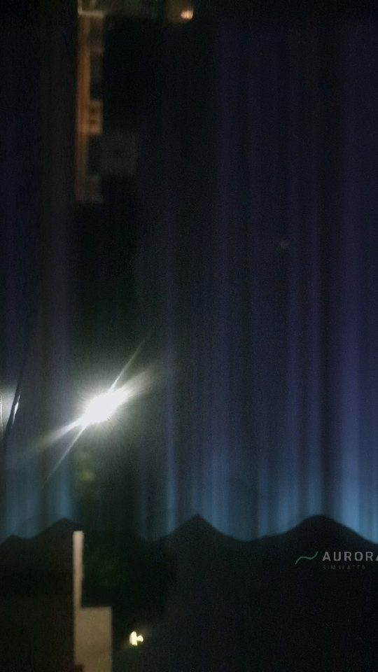

# Recording tests and results

Status date: **2026-11-13**. Build: debug, `com.auroraar.debug` 0.1.3-debug (versionCode 4).

> A Samsung Galaxy S10 (`SM-G973N`, Android 12) was connected on 13 November
> 2026. The JVM suite and the first hardware capture pass; the 27-case manual
> matrix is still mostly open. Results below distinguish **PASS**, **PARTIAL**
> and **NOT RUN**. The first capture was a pipeline check against a wall and
> streetlight in Creative mode, not an open-sky beauty shot.

---

## 1. Automated JVM suite

Command (all toolchain, caches and SDK inside this folder):

```powershell
$env:GRADLE_USER_HOME = "$PWD\.toolchain\gradle-home"
$env:ANDROID_HOME     = "$PWD\.toolchain\android-sdk"
.\gradlew.bat testDebugUnitTest --console=plain
```

Result:

```
BUILD SUCCESSFUL
24 test classes, 164 tests, 0 failures, 0 errors
```

`lintDebug`: **0 errors, 10 warnings** (nine dependency-update notes, one
obsolete `mipmap-anydpi-v26` note). `assembleDebug`: APK
**12,228,966 bytes**, permissions `CAMERA`, `RECORD_AUDIO`,
`ACCESS_COARSE_LOCATION` only.

| Test class | Tests | What it covers |
|---|---:|---|
| `RecordingPolicyTest` | 6 | Free 720p / 10 s / watermark vs Premium 1080p / unlimited / no watermark; duration formatting; watermark visibility; active phase set; HEVC/60 fps/4K flags stay off |
| `RecordingGuardsTest` | 9 | storage / battery / thermal refusals and warnings, boundaries, unknown battery, precedence, charging exceptions |
| `RecordingEventGuardTest` | 7 | finalize/save event ordering, duplicate callbacks and stale-take guards |
| `PendingRecordingCleanupTest` | 4 | 60 s grace period; recent, missing and future `dateAdded` are not stale |
| `DeviceRecordingCapsTest` | 7 | per-codec resolution/frame-rate support, hardware flags, empty-device fallback, unknown `maxFps=0`, summary text |
| `RecordingGalleryQueryTest` | 5 | gallery selects only `Movies/AuroraAR/`, not sibling folders sharing the prefix |
| `FeatureGateTest` | 6 | Free styles open to both tiers; Premium styles locked; unknown id fallback; Free downgrades grade/automation/advanced values; Premium keeps choices |
| `AuroraStyleRegistryTest` | 11 | 5 Free + 7 Premium, unique ids, five geometries, shader-contract ranges, opaque palette, pink/blue styles free and emission-based, measured magenta signature |
| `AuroraEmissionTest` | 10 | measured 428/557.7/630 nm heights, blue-green-red vertical order, curtain-local screen mapping, non-finite fallback |
| `IntensityMapperTest` | 9 | daylight/cap/stars behaviour, style geometry/palette/layers/waves/burst/direction reaching uniforms, cinematic grade + grain, automation, emission flag reaching Free renders |
| `SkyScoreFormulaTest` | 14 | §9.3 table + illustrative example |
| `SkyMaskColorTest` | 12 | colour plausibility |
| `MessagePolicyTest` | 14 | message selection, including "open gate but nothing drawn" no longer promising an aurora |
| `NonFiniteInputTest` | 7 | NaN/∞ sliders, probabilities and features |
| `CameraBlockedTest` | 5 | covered lens vs dark overcast vs live night |
| `SkyScoreEngineTest` | 9 | end-to-end gates, smoothing, Off mode and render-parameter gating |
| `PhaseClassifierTest` | 5 | day/sunset/twilight/night |
| `PhaseHysteresisTest` | 4 | hysteresis and no oscillation |
| `StarCounterTest` | 5 | star robustness |
| `YuvColorTest` | 4 | limited-range YUV |
| `AstronomyPriorTest` | 2 | solar position |
| `CreativeGateTest` | 2 | Creative bypass |
| `ClassifierRobustnessTest` | 2 | adversarial features |
| `HoldStopTest` | 5 | hold-to-record release and limit guards |

Failures: **none**.

## 2. Required v5 automated tests that do not exist

These need a device/emulator and are **not implemented**:

| Requirement | Status |
|---|---|
| Record 10 s → decode with `MediaExtractor`/`MediaMetadataRetriever`, assert tracks/duration/resolution | **PARTIAL (manual)** — PyAV decoded a 720×1280 H.264 clip, 10.13 s, identity matrix; aurora and watermark present. The MediaExtractor assertion is not written |
| Free auto-stop at 10.0 s, Premium ≥ 5 min | **PARTIAL** — Free stopped at 10.13 s (encoder latency); Premium long take not run |
| Pause/resume duration and no-gap timeline | **NOT RUN** |
| A/V sync clap test < 40 ms, 5-minute drift | **NOT RUN** — the first clip was silent |
| Colour: preview screenshot vs first decoded frame | **PASS (manual)** — preview and decoded frame match |
| Alignment test with debug world grid (≤ 3 px at 60°/s) | **Cannot run** — the app has no world grid or world-locked aurora; see `tools/alignment_check.py` |
| Occlusion-in-video leakage / thin-structure recall | **NOT RUN** — no segmentation/depth occlusion exists |
| 100 start/stop cycles, leak and orphan check | **NOT RUN** |

Instrumented tests can be added under `app/src/androidTest` once a device is
available. The JVM suite deliberately keeps policy, gating, guards and geometry
math testable without Android.

## 3. Manual device matrix

Record one result per device. Device: **Samsung Galaxy S10 (`SM-G973N`), Android 12 / API 31**, 13 Nov 2026.

| # | Test | Expected | Result |
|---|---|---|---|
| 1 | Install Android 10+, grant camera, open screen | Live aurora, record enabled | **PASS** |
| 2 | Free take, 10 s | Last-3-s countdown + haptics, auto-stop, preview, watermark | **PARTIAL** — 10.13 s file, preview opened, watermark horizontal; countdown/haptics not checked |
| 3 | Pause 5 s, resume, stop | Duration and timeline exclude pause | NOT RUN |
| 4 | Debug Premium, record > 10 s | 1080p, no watermark, no limit | NOT RUN — debug Premium toggled, but no long take |
| 5 | Deny microphone | Silent clip, "Silent" marker | NOT RUN — audio was switched off in app settings, so permission denial was never exercised |
| 6 | Portrait, landscape, rotate mid-take | Upright files, no activity recreation | **PARTIAL** — portrait only |
| 7 | Flip camera, then record and flip | Flip disabled while recording | NOT RUN |
| 8 | Share / delete / record again | Chooser, deletion, fresh take | **PARTIAL** — actions shown; a second take was recorded, share/delete not pressed |
| 9 | Home during take, return | Saved playable file | NOT RUN |
| 10 | Storage < 500 MB then < 100 MB | Warning then refusal / clean stop | NOT RUN |
| 11 | Battery < 15% then < 5% unplugged | Warning then refusal / stop | **PARTIAL** — 7-8% warning toast appeared; clip saved; <5% stop not run |
| 12 | Thermal `MODERATE` / `CRITICAL` | Warning / clean stop | NOT RUN |
| 13 | Effect composition rejected | Preview-only fallback, message | NOT RUN |
| 14 | Android 8–9 | Legacy file + MediaScanner, FileProvider share | NOT RUN |
| 15 | 30-min Premium soak | Playable file; measure drift/FPS/temperature | NOT RUN |
| 16 | Share to Photos / WhatsApp / Instagram / YouTube | Correct colour, orientation, duration | NOT RUN |
| 17 | Incoming call / audio-focus loss | Take pauses, resumes/stops cleanly | NOT RUN |
| 18 | Free taps Premium style | 3 s live preview then paywall | **PASS** |
| 19 | Debug Premium styles/looks/controls | Preview and file match; persists after restart | **PARTIAL** — toggle on/off only |
| 20 | Photo idle / during recording | `Pictures/AuroraAR`, no watermark / blocked toast | **PARTIAL** — idle 1080×1440 JPEG, no watermark; during-recording not run |
| 21 | Gallery list / play / share / delete | Thumbnails and actions work | NOT RUN |
| 22 | Hold-to-record, release during `PREPARING`, hold to limit | No runaway take; limit saves | NOT RUN |
| 23 | Hold-to-record with mic denied | Silent take, no permission dialog in gesture | NOT RUN |
| 24 | Kill process during take, relaunch | No playable pending row / stale temp | NOT RUN |
| 25 | Settings encoder list | Matches `MediaCodecList`, no false 4K/60 | **PASS** — H.264/H.265 hardware 8192×8192, H.264 software 2048×2048, H.265 software 512×512@30 |
| 26 | Camera open with 15 s screen timeout | Display stays on; flag released on exit | NOT RUN |
| 27 | Mic revoked mid-take / process death | **Not implemented**; may end early | NOT RUN |

## 4. First hardware frame

Real decoded frame from the SM-G973N take (5.0 s in), not a render or mockup:



What it proves: CameraX fed the effect pipeline, the GL compositor drew the
aurora, the encoder wrote H.264, and the Free watermark rendered horizontally.
What it does not prove: sky detection, AUTO-mode intensity, audio, or a
good-looking shot. The camera faced a wall and streetlight, so SkyScore read
3/100 and the take used Creative mode. The watermark's right edge is visibly
clipped — a layout bug still open. A texture-fit fix and one-shot geometry
logging are in the build, but they have not run on the phone yet.

## 5. Coverage honesty

- The GL compositor, CameraX effect binding, H.264 encoder, MediaStore
  finalisation, `VideoView` preview and photo readback ran on the SM-G973N.
  Audio focus, gallery thumbnails, share/delete, pause/resume, camera flip,
  hold-to-record and the remaining matrix cases are still compile-verified only.
- The first hardware capture clipped the Free watermark's right edge slightly;
  the layout needs a device pass.
- `tools/alignment_check.py` is a measurement harness, not a passing test. It
  requires OpenCV and a clip with a known world grid. This build does not render
  that grid and the aurora is screen-space, so there are no alignment numbers.
- Billing tests are impossible without Play Console products and the `INTERNET`
  permission. `Entitlements` is a local debug switch only.
